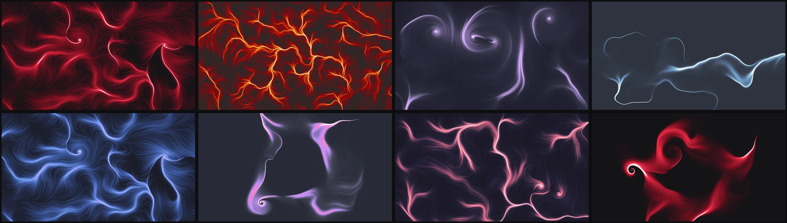

# Ember Field

Flow-field wallpapers that match your desktop theme.

**[Open the studio →](https://kemonoo.github.io/emberfield/)**



Tens of thousands of particles drift through a seeded noise field. Where their trails pile up, the colour heats up through your theme's palette. Every wallpaper is described by a short **recipe**, so the same code always gives the same picture, at any resolution:

```
ember1:s9001,f3.2,o5,v0,w0,p40,l180,e1.1,g0.7,cgruvbox,mscatter
```

Post a recipe and anyone can reproduce your wallpaper exactly, or change the seed to get a new one in the same style.

## Features

- **Theme palettes**: Catppuccin, Gruvbox, Nord, Tokyo Night, Dracula, Rosé Pine and Everforest, plus four Crimson variants. Each palette's darkest stop is the theme's own background colour, so empty areas of the wallpaper blend into your terminal.
- **Any size**: Full HD, QHD, 4K, 16:10, ultrawide and phone, rendered at full resolution in your browser.
- **Desktop preview**: lay a mock bar and a translucent terminal over the wallpaper to check readability before you commit.
- **Shareable links**: the studio's URL always contains the current recipe.
- **A command-line tool** that renders a recipe and sets it as your wallpaper.

## Reading a recipe

| Key | Setting | Range |
|---|---|---|
| `s` | seed | 0–999999 |
| `f` | field scale (bigger = tighter swirls) | 0.3–6 |
| `o` | turbulence (noise octaves) | 1–6 |
| `v` | number of vortices | 0–5 |
| `w` | vortex pull | 0–2 |
| `p` | particles, in thousands | 2–80 |
| `l` | trail length, in steps | 40–800 |
| `e` | exposure | 0.1–4 |
| `g` | vignette | 0–1 |
| `c` | palette (`ember-wall --palettes` lists them) | |
| `m` | spawn pattern: `scatter`, `ring`, `horizon`, `core` | |

## The command-line tool

`ember-wall` renders a recipe to a PNG. It has no dependencies, but it needs Node.js 22.2 or newer.

```sh
git clone https://github.com/Kemonoo/emberfield.git
ln -s "$PWD/emberfield/bin/ember-wall" ~/.local/bin/ember-wall

ember-wall                                  # random seed, default style
ember-wall ember1:s4821,...,ccrimson,mscatter --set     # render and set with feh
ember-wall ember1:s4821,... --size 3840x2160 --out ~/wall.png
```

`--set` runs `feh --bg-fill`. The first time, it backs up your existing `~/.fehbg` to `~/.fehbg.pre-ember.bak`.

## Text art for fastfetch

`ember-ascii` renders a recipe as coloured braille art, sized for a terminal logo:

```sh
ember-ascii ember1:s926625,f1.2,o4,v3,w1,p30,l400,e0.45,g0.5,ccrimson,mring --rows 18 --out ~/.config/fastfetch/logo.txt
ember-ascii --ansi                     # preview the default emblem in your terminal
```

The file uses fastfetch's `$1`–`$4` colour markers. The command prints matching `logo.color` values in 24-bit colour, so the art uses your palette's exact colours. Use `--gain`, `--floor` and `--contrast` to tune how bold or dithered it looks. Pass `--mask shape.pgm` to pour the swirls into a silhouette (shapes are in `masks/`); `node tools/logos.js` renders a whole set plus a `preview` script into `~/.config/fastfetch/logos/`.

## Gallery

The recipes behind the studio's gallery live in [`gallery.json`](gallery.json). Ready-made PNGs are attached to the [latest release](https://github.com/Kemonoo/emberfield/releases/latest).

## Project layout

| Path | What it is |
|---|---|
| `emberfield.js` | the generator: noise field, particle tracing, tone mapping. Runs in browsers and Node. |
| `bin/ember-wall` | the CLI, including a small built-in PNG encoder |
| `bin/ember-ascii` | braille text art from a recipe |
| `studio.html` | the studio page |
| `tools/build.js` | builds the site into `docs/` for GitHub Pages |
| `tools/thumbs.sh` | renders the gallery thumbnails |

## License

Code: [MIT](LICENSE). Generated images, including the gallery: [CC0](LICENSE-images), so use them however you like.
Theme colours belong to their respective projects: [Catppuccin](https://github.com/catppuccin/catppuccin), [Gruvbox](https://github.com/morhetz/gruvbox), [Nord](https://www.nordtheme.com), [Tokyo Night](https://github.com/folke/tokyonight.nvim), [Dracula](https://draculatheme.com), [Rosé Pine](https://rosepinetheme.com), [Everforest](https://github.com/sainnhe/everforest).

Made by [Kemonoo](https://github.com/Kemonoo) with Claude.
